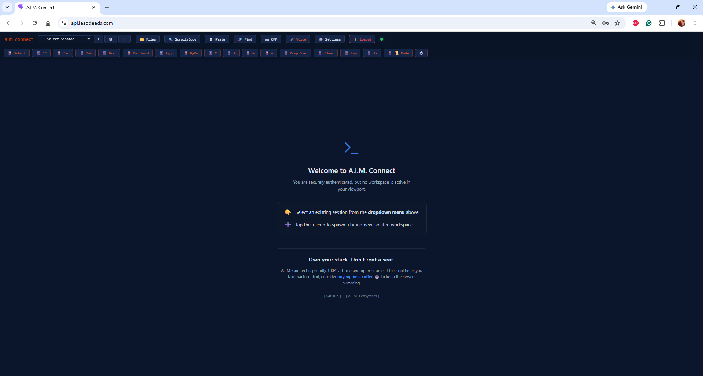
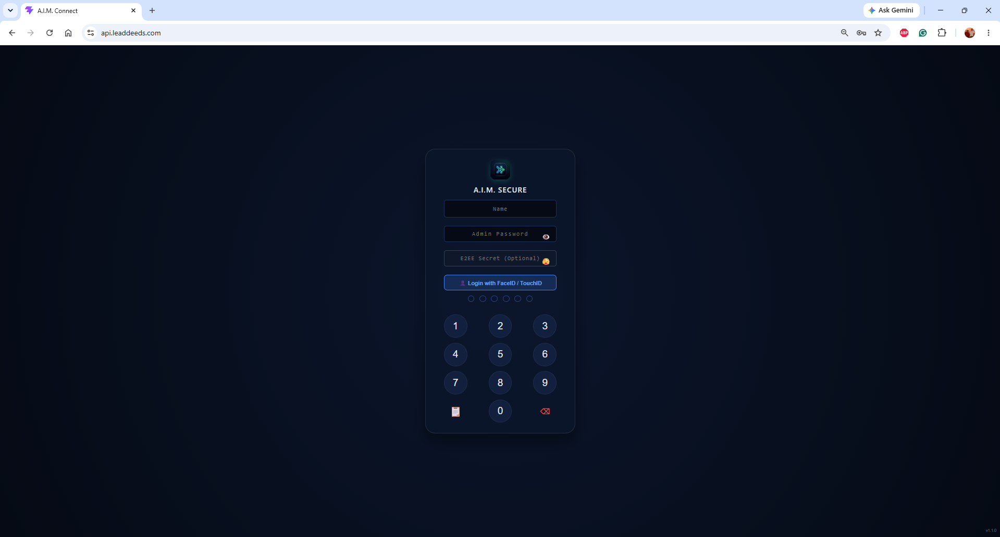
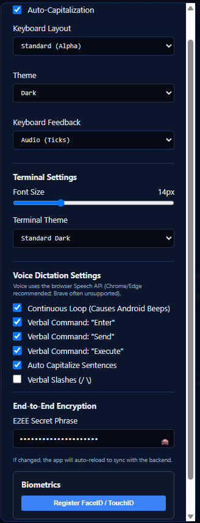
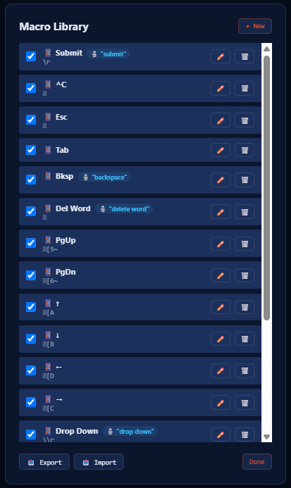
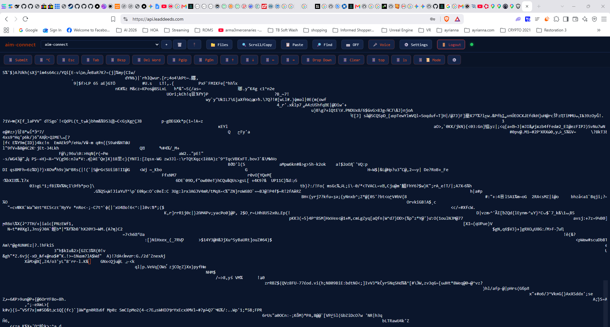
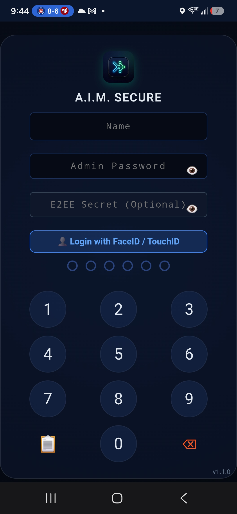
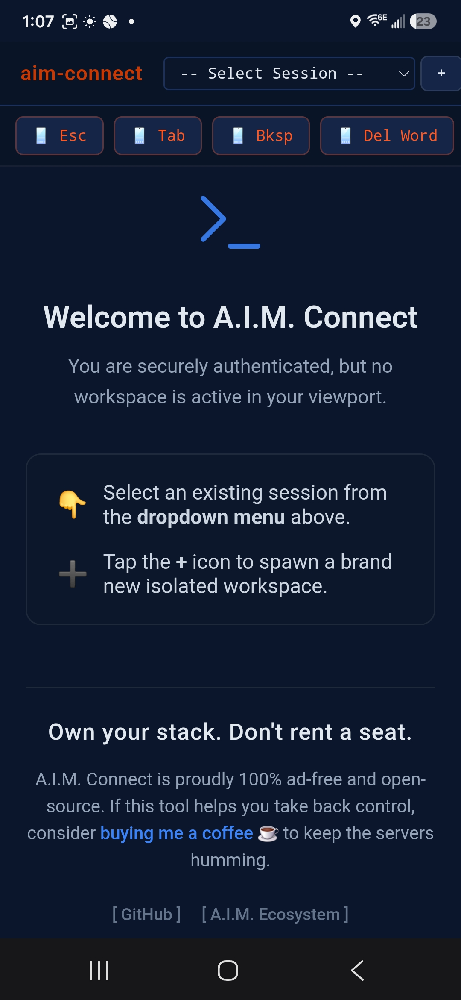
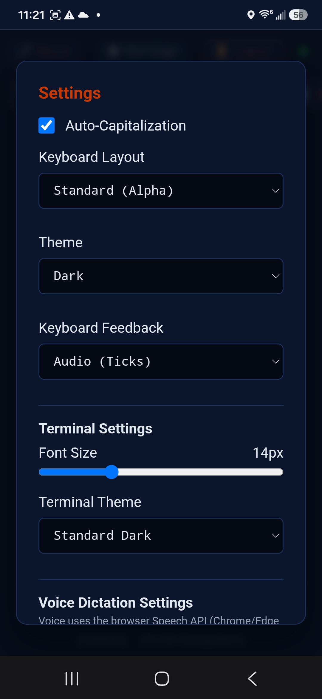
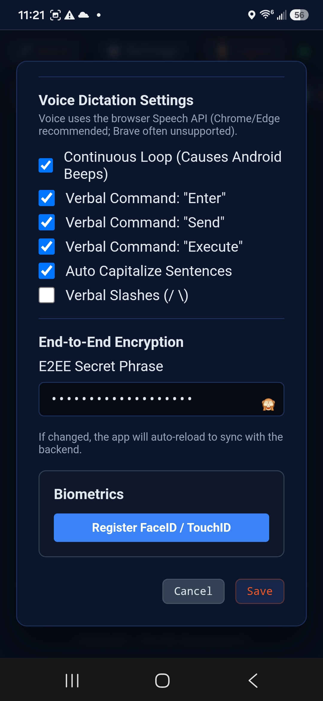

# 🛸 AIM-Connect

[](LICENSE)
[](https://buymeacoffee.com/brianv1981)

**A Clientless, Sovereign Web Terminal & AI Agent Fleet Cockpit.**

AIM-Connect transforms any web browser on any device into a secure, root-level command center for your Linux server and autonomous CLI coding agents. No SSH keys to carry, no terminal apps to download, and no corporate bouncers. Just raw, unrestricted access to your machine and your entire `tmux` fleet from anywhere on Earth.

<p align="center">
  
</p>

### Desktop
| 3FA + WebAuthn login | Settings | Voice macros | E2EE (ciphertext on the wire) |
|---|---|---|---|
|  |  |  |  |

### Android
| Login | Home | Settings | Voice |
|---|---|---|---|
|  |  |  |  |

---

## ⚡ The Philosophy

Standard SSH requires you to have a dedicated terminal emulator app and your private keys stored on your physical device. If you are on a locked-down corporate laptop, a friend's iPad, or a public library computer, you are locked out of your own server.

**AIM-Connect changes the paradigm.**
By wrapping standard `tmux` sessions in a secure WebSocket and serving them through a FastAPI React bridge, you can securely access your running server scripts using nothing but a web browser.

## 🚀 Key Features

*   **Clientless SSH & Immortal `tmux` Streams:** Access your server from Safari, Chrome, or Firefox with zero App Store installs. Close your browser, put your phone in your pocket, and your processes keep running—log back in and instantly re-attach to the live PTY stream.
*   **Multi-Session AI Fleet Cockpit (`Fleet Sidebar`):** Supervise dozens of concurrent `tmux` workspaces and autonomous CLI coding agents (`Claude`, `Codex`, `OpenCode`, `Grok`, `Antigravity`) from a single sidebar with live status badges (`THINKING`, `✋ Waiting` approval chimes, `ERROR`, `IDLE`), 30%-Rule context saturation meters, and sticky-red compaction radar.
*   **Keyboard-First `Cmd+K` Command Palette & Token Grabber:** Teleport across sessions, dispatch slash commands, or extract deduplicated URLs (with automatic secret-query redaction), file paths, IPs, and git SHAs straight from terminal scrollback without touching a mouse.
*   **Split-Pane Web IDE, Session Brain, & Git Diff (`Monaco Engine`):** Open `📁 Files` side-by-side without unmounting your live terminal. Edit code with VS Code's Monaco engine, inspect session-scoped project docs and active git worktrees, prevent lost edits with `HTTP 409` `mtime` conflict detection, and review working-tree changes in a syntax-highlighted side-by-side Monaco Diff viewer.
*   **Cross-Fleet FTS5 Forensics & Swarm Feed:** Search structured agent transcripts and tool-call histories across your entire machine via SQLite WAL `FTS5` (`?mode=ro`) and monitor inter-agent dispatches in real time.
*   **`🔊` Neural TTS Spoken Briefings (`Piper ONNX` + `Edge Neural`):** Hear plain-English spoken summaries of agent completions hands-free on mobile or desktop using offline local `piper-tts` ONNX voices or cloud Microsoft Edge Neural voices (with automatic offline and browser Web Speech fallback).
*   **Three-Factor Auth + WebAuthn Biometrics (Zero-Trust):** Secured by Stealth Passphrase + Admin Password + TOTP (with replay protection, rate limiting, and IP allowlisting), plus optional passwordless **FaceID / TouchID / YubiKey** login via FIDO2 WebAuthn and multi-user `users.json` support.
*   **Client-Side End-to-End Encryption (`AES-256-GCM`):** Optionally scramble keystrokes and terminal streams in the browser *before* they hit the WebSocket so traffic stays opaque even to your TLS reverse proxy.
*   **Sovereign Mobile Keyboard, Voice Macros, & Native Copy Mode:** Custom on-screen developer keyboard (`Tab`, `Esc`, sticky `Ctrl`, pipes, brackets) that suppresses mobile autocorrect ghosting, a 100% free programmable **Voice Trigger** dictation engine, and a memoized ANSI **Scroll/Copy** overlay with 1-tap selection copy.
*   **Multi-Tenant Sovereign Agent Gateway (`bwrap` Isolation):** Act as a headless terminal backend for external web apps using HMAC-SHA256 magic-link JWTs (`AIM_GATEWAY_SIGNING_SECRET`), spawning per-user Bubblewrap (`bwrap`) sandboxes with per-JWT WebSocket E2EE transport keys and a host-only loopback email relay.

---

## 🛠️ Installation & Setup (End-to-End)

### Step 1: Clone and Configure
1. **Clone the repository:**
   ```bash
   git clone https://github.com/BrianV1981/aim-connect.git
   cd aim-connect
   ```
2. **Configure your Environment (`.env`):**
   ```bash
   cp .env.example .env
   ```
   *Edit `.env` to configure your optional settings:*
   - `ALLOWED_IPS`: (Optional) Comma-separated list of IPs allowed to access the server (e.g., `192.168.1.5,203.0.113.42`). Leave blank to allow all IPs.
   - `AIM_PUBLIC_URL` / `CLOUDFLARED_CONFIG`: (Optional) Display URL and Cloudflare Tunnel config path if exposing beyond `http://localhost:8000`.

### Step 2: Build the Frontend
You must compile the React assets before launching the backend.
```bash
cd frontend
npm install
npm run build
cd ..
```

### Step 3: Install Backend Dependencies
```bash
cd backend
python3 -m venv venv
source venv/bin/activate
pip install -r requirements.txt
cd ..
```

### Step 4: First-Time Launch & Credential Setup
You must run the startup script directly in your terminal the very first time to capture your credentials.
```bash
./startup.sh
```
**CRITICAL SETUP INSTRUCTION:**
On first launch, AIM-Connect auto-generates three credentials and prints them to the console:

1. **TOTP Secret (QR Code):** A QR code for Google Authenticator / Authy. Scan it with your phone.
2. **Admin Password:** A secure random password. Save it in your password manager.
3. **Stealth Passphrase:** A secret passphrase for the "Name" field on the login screen. Save this too — it's your third auth factor.

> ⚠️ You will **never** see these credentials again after first launch. If you lose them, delete the corresponding `.hash` or `.secret` file and restart to regenerate.
>
> **To reset:** `rm backend/passphrase.hash && ./startup.sh` (or `backend/password.hash` / `backend/totp.secret`)

### Step 5: Accessing the Dashboard
1. Open `http://localhost:8000` locally (or your configured HTTPS tunnel URL on your phone or remote browser).
2. You will be greeted by the **AIM Secure** login screen with three fields.
3. Enter your **Stealth Passphrase** in the "Name" field, your **Admin Password**, then your **6-digit TOTP pin** from your authenticator app.
4. You are in!

### Step 6: PWA & Multi-Server Theming (Optional)
AIM-Connect is a Progressive Web App (PWA). You can install it natively on your phone by tapping "Add to Home Screen" in your mobile browser.

If you are running multiple servers (e.g. a Raspberry Pi, a Gaming PC, and a Cloud VPS) and want to have multiple AIM-Connect icons on your phone's home screen, you can easily customize the app name and theme color for each server without modifying any code. 

1. Open your `.env` file on the server.
2. Add the following environment variables:
   ```bash
   AIM_APP_NAME="Gaming Node"
   AIM_APP_COLOR="#8b0000"
   ```
3. Restart the server using `./startup.sh`. The backend will dynamically rewrite the PWA manifest so your phone treats it as a completely unique application!

---

## 🛠️ Development & Hacking Setup

If you want to actively modify the UI, use this split-terminal setup:

1. **Terminal 1 (Backend):**
   ```bash
   cd backend
   source venv/bin/activate
   uvicorn main:app --host 0.0.0.0 --port 8000 --reload
   ```
2. **Terminal 2 (Frontend Dev Server):**
   ```bash
   cd frontend
   npm run dev -- --host
   ```
3. **Terminal 3 (The Tunnel):**
   You must expose the frontend over HTTPS to use secure features. You have two options:
   
   **Option A (Permanent URL - Requires Ngrok Account):**
   ```bash
   ngrok http --url=your-static-domain.ngrok-free.dev 5173
   ```
   **Option B (Quick Temporary URL - No Account Needed):**
   ```bash
   npx -y cloudflared tunnel --url http://localhost:5173
   ```

---

## 🐳 Deployment (Docker)

AIM-Connect ships with a hardened, multi-stage Dockerfile:
- **Stage 1** builds the React frontend (no Node.js in the final image)
- **Stage 2** runs the Python backend as a **non-root user** (`appuser`)
- Includes a `HEALTHCHECK` endpoint at `/api/health`
- Persists 3FA hashes, TOTP secrets, and WebAuthn credentials in a dedicated `aim-auth-data` Docker volume (`/app/auth_data`) across container rebuilds while keeping backend source code isolated from host bind-mounts
- Binds `127.0.0.1:8000` on the host by default (override via `AIM_BIND_HOST` in `.env`) so `http://localhost:8000` and local reverse proxies/tunnels work immediately without exposing raw HTTP to public interfaces

**Quick start:**
1. *(Optional)* `cp .env.example .env` and customize `ALLOWED_IPS`, `AIM_APP_NAME`, or `AIM_BIND_HOST`.
2. Run `docker compose up -d --build`.
3. Check the logs (`docker logs aim-connect -f`) to capture your initial TOTP QR Code, admin password, and stealth passphrase, then open `http://localhost:8000` (or route your HTTPS tunnel to `localhost:8000`).

---

## 🌐 Networking & Tunneling Playbook (Sovereign OS Access)

Out of the box, `./startup.sh` boots AIM-Connect locally on `http://localhost:8000` in idempotent health-check mode (and automatically starts an authenticated Cloudflare Tunnel if `CLOUDFLARED_CONFIG` is present). While Ngrok is great for quick tests, Ngrok's free tier has strict bandwidth caps (~1GB/month) which live pseudo-terminals will quickly exhaust. 

If you are building a production-grade Web OS, or just need to bypass a ban, here is the complete playbook of your tunneling options:

### 🏆 Tier 1: Production SaaS (Permanent & Unlimited)
These options provide completely unrestricted bandwidth, no splash screens, and permanent static URLs.

**1. Authenticated Cloudflare Tunnels (Zero-Config Firewall Punching)**
If your node is behind a strict router/firewall and you don't have a public IP, this is the ultimate solution.
*   **Setup:** Download `cloudflared`, run `cloudflared login`, and permanently bind port `8000` to a domain you own in Cloudflare.
*   **Pros:** 100% free, unlimited bandwidth, static domain (e.g., `api.yourdomain.com`), enterprise DDoS protection, bypasses all NATs without opening router ports.
*   **Cons:** Requires a free Cloudflare account and a registered domain name.

**2. Nginx + Let's Encrypt (The Native Standard)**
If the physical machine running AIM-Connect has a static Public IP address (e.g., a Cloud VPS or Business ISP).
*   **Setup:** Point a real domain to your IP. Install Nginx and configure it as a reverse proxy to route traffic directly to port `8000`. Secure it with an auto-renewing SSL certificate via Certbot.
*   **Pros:** Native speed, zero third-party proxies, completely self-hosted infrastructure.
*   **Cons:** Exposes an open port on your network (though AIM-Connect's 3FA protects the application layer).

### 🛠️ Tier 2: Temporary Hacks (Local Dev & Bypassing Bans)
If you hit an Ngrok limit but just need to get back online instantly without registering a domain.

**1. Localtunnel (The Ngrok Alternative)**
*   **Run:** `npx -y localtunnel --port 8000 --subdomain my-custom-name`
*   **Pros:** Free, unrestricted bandwidth, incredibly easy to run via Node.js.
*   **Cons:** **The Splash Screen.** Localtunnel injects a phishing-protection screen on first visit. To use WebSockets, you *must* open the proxy URL in a separate browser tab and click "Click to Continue" to whitelist your IP before logging into the AIM dashboard.

**2. Pinggy / Serveo (Zero-Install SSH Proxies)**
*   **Run:** `ssh -p 443 -R0:localhost:8000 a.pinggy.io` or `ssh -R 80:localhost:8000 serveo.net`
*   **Pros:** Literally requires zero installation—it's built into SSH. Instantly gives you a public HTTPS URL.
*   **Cons:** The free tiers have strict session timeouts (e.g., 60 minutes) and the URLs change randomly upon restart.

**3. Cloudflare "Quick Tunnels" (Anonymous)**
*   **Run:** `cloudflared tunnel --url http://localhost:8000`
*   **Pros:** Free, no account required.
*   **Cons:** Extremely flaky. Generates a random `trycloudflare.com` URL that changes every restart and often hangs during initialization.

### 🛡️ Tier 3: Sovereign Mesh (Highest Security, No Public URLs)
If you want to use AIM-Connect but refuse to expose it to the public internet whatsoever.

**1. Mesh VPN (Tailscale / WireGuard)**
*   **Setup:** Install Tailscale on your server and your phone, set `ALLOW_HTTP=true` in your `.env` (since WireGuard already encrypts the mesh transport; if using Docker, also set `AIM_BIND_HOST=100.x.x.x`), and access AIM-Connect via the internal VPN IP (e.g., `http://100.x.x.x:8000`) or `tailscale serve`.
*   **Pros:** Zero public exposure, mathematically impossible to port-scan.
*   **Cons:** Requires the VPN app to be active on your client device, completely defeating the "Clientless SSH" philosophy if you are using a public or borrowed computer.

### ⚠️ Troubleshooting: WSL & Cloudflare Tunnels (DNS Cache NXDOMAIN)
If you are running `cloudflared` on Windows Subsystem for Linux (WSL) and your tunnel fails to resolve locally (e.g., `Name or service not known` or `i/o timeout` on the frontend):

**The Problem:**
WSL automatically provisions its `/etc/resolv.conf` to forward DNS queries to your Windows host's virtual switch (e.g., `nameserver 10.255.255.254`). If you attempt to access your new Cloudflare Tunnel domain *before* it has fully propagated globally, your Windows host will aggressively cache a negative response (`NXDOMAIN`). WSL inherits this poisoned cache, meaning your host can no longer resolve its own tunnel, silently breaking your frontend connection.

**The Fix:**
You must bypass the Windows host's DNS cache entirely by hardcoding public DNS servers inside your WSL Linux environment.
1. Unlink the auto-generated file: `sudo rm /etc/resolv.conf`
2. Create a new static file: `sudo nano /etc/resolv.conf`
3. Add direct nameservers:
   ```text
   nameserver 1.1.1.1
   nameserver 8.8.8.8
   ```
4. Prevent WSL from overwriting it on reboot by adding `generateResolvConf = false` to your `/etc/wsl.conf` under the `[network]` block.
This forces WSL to query the public internet directly, instantly resolving the connection.

**WebSocket Stream Drops Over QUIC (`protocol: http2`):**
By default, `cloudflared` negotiates `QUIC` (`UDP :7844`). On Linux/WSL2 hosts with default `208 KB` kernel UDP socket buffers (`net.core.rmem_max = 212992`) or aggressive residential UDP NATs, bursty full-screen terminal redraws can trigger intermittent `1006` WebSocket resets. Add `protocol: http2` to the top of your `cloudflared` `config.yml` (or raise `net.core.rmem_max` / `net.core.wmem_max` to `7500000`) for rock-solid long-lived PTY streams.

### 💡 Pro-Tip: Bypassing the 7-Day Google OAuth Expiration
When setting up custom Google Cloud credentials for tools like Rclone or personal AI agents connected to AIM, users often hit the "token expires every 7 days" Testing restriction. You do **not** need formal verification to push personal apps to Production!
1. Go to **APIs & Services > OAuth consent screen > Branding** and explicitly type in the App Name, Support Email, and Developer Contact (beware of the grey ghost text).
2. For the required Homepage and Privacy Policy URLs, simply point a dead Cloudflare Tunnel (e.g. `cloudflared tunnel route dns <id> my-app.domain.com`) to a domain you own. Paste `https://my-app.domain.com` and `https://my-app.domain.com/privacy` into the form. Google only checks syntax and domain matches, it does not crawl the page.
3. Add the domain to the **Authorized domains** list, leave the logo blank, and click **Publish App**. Ignore the "Unverified App" warning when you log in, click **Advanced -> Go to App**, and your token will last forever.

---

## 📖 How to Use the UI

*   **Fleet Sidebar & Session Control:** Open the **Fleet Sidebar** to monitor all active `tmux` sessions, inspect live status (`THINKING`, `✋ Waiting`, `IDLE`) and 30%-Rule context meters, spawn new sessions, dispatch quick commands, or delete workspaces via the per-card `🗑️` button. Tap `aim-connect` in the header to return to the Welcome Screen.
*   **`Cmd+K` Command Palette & Token Grabber:** Press `Cmd+K` (or `Ctrl+K`) to jump between sessions, toggle cockpit tools, or open the **Token Grabber** to copy URLs, file paths, IPv4s, and git SHAs extracted from terminal scrollback.
*   **Split-Pane File Explorer, Brain, & Diff IDE:** Tap `📁 Files` to open the non-unmounting split-pane workspace alongside your live terminal. Browse files, inspect session Brain docs and active worktrees, view side-by-side **Git Diffs**, or edit and save with `mtime` conflict protection.
*   **Forensics & Swarm Inspector:** Open **Forensics** to inspect structured agent tool-call turns, run instant SQLite `FTS5` cross-fleet transcript searches, and view inter-agent Swarm dispatches.
*   **`🔊` Neural TTS & Alert Chimes:** Tap `🔊 Speak` (or enable Auto-Playback in Settings) to hear spoken summaries via local `piper-tts` ONNX or Edge Neural voices, and keep `🔔 Agent Alert Chime` enabled to get notified the moment a background session needs input (`✋ Waiting`) or finishes work.
*   **Commander Toolbar & Sovereign Keyboard:** Tap `⚙️` on the Commander Toolbar to pin local (📱) or server-synced (☁️) macros, and tap `⌨️` to toggle the ghost-free Sovereign Mobile Keyboard (`Tab`, `Esc`, sticky `Ctrl`, pipes, brackets).
*   **Voice Dictation & Scroll/Copy Mode:** Tap `🎤 Voice` for speech-to-terminal input and programmable Voice Triggers, or tap `🔍 Scroll/Copy` to highlight and copy clean ANSI or plain-text scrollback (`✂️ Copy Selection`) without mobile selection collapse.
*   **Settings, WebAuthn, & E2EE:** Tap `⚙️ Settings` to register **FaceID / TouchID** passkeys, select TTS voices and terminal themes, or configure client-side **AES-256-GCM E2EE** (`ENABLE_E2EE=true` and `E2EE_SECRET` on the server).

---

> [!CAUTION]
> **FULL ROOT-LEVEL TERMINAL ACCESS**
> AIM-Connect grants full, unbridled terminal execution rights to whatever user executes the backend script. This is the equivalent of exposing SSH to the web.
> 
> **MANDATORY SECURITY PROTOCOLS:**
> 1. **HTTPS IS STRICTLY REQUIRED:** You must ALWAYS run this application behind a secure SSL/TLS tunnel (like Ngrok, Cloudflare Tunnels, or an Nginx Reverse Proxy). If you run this over raw HTTP, your keystrokes (and TOTP codes) can be trivially intercepted.
> 2. **IP Allowlisting:** Strongly recommended. Configure `ALLOWED_IPS` in your `.env` to restrict access to trusted networks.
> 3. **Basic Path Traversal Protection:** While the web-UI file endpoints have basic path-traversal blocks to keep navigation scoped, the terminal itself has no such restrictions. 
> 4. **Protect Your Keys:** The `.env` file containing your Ngrok auth tokens and backend secrets must never be committed to source control.

---

## 🧪 Testing

AIM-Connect includes a full pytest test suite covering authentication and security:

```bash
cd backend
source venv/bin/activate
pip install -r requirements-test.txt
python -m pytest tests/ -v
```

**170+ tests** covering:
- Three-factor auth flow (passphrase + password + TOTP), TOTP replay protection, and WebAuthn `rp_id` resolution
- Rate limiting, lockout eviction, token expiry, and loopback/proxy boundaries
- Fleet Sidebar telemetry, 30%-Rule & compaction radar, `✋ Waiting` alerts, and `🔊` Neural TTS extraction
- Split-pane IDE `mtime` conflict guards, path traversal prevention, FTS5 forensics, and URL token secret redaction
- Per-JWT WebSocket AES-256-GCM transport encryption, `bwrap` sandbox SMTP credential isolation, and repository shareability guards

Tests also run automatically via GitHub Actions CI on every push and PR to `master`.

---
*Built with sovereignty in mind.*

☕ **Support the project:** [Buy Me a Coffee](https://buymeacoffee.com/brianv1981)

<!-- AIM_ECOSYSTEM_START -->
### 🧬 The A.I.M. Ecosystem

AIM-Connect is just one module in the larger A.I.M. (Actual Intelligent Memory) architecture. 

To see how the sovereign OS, AI agents, MCP servers, and terminal multiplexers all connect, please visit the central ecosystem repository:

👉 **[The A.I.M. Ecosystem Directory](https://github.com/BrianV1981/aim-ecosystem)**
<!-- AIM_ECOSYSTEM_END -->

